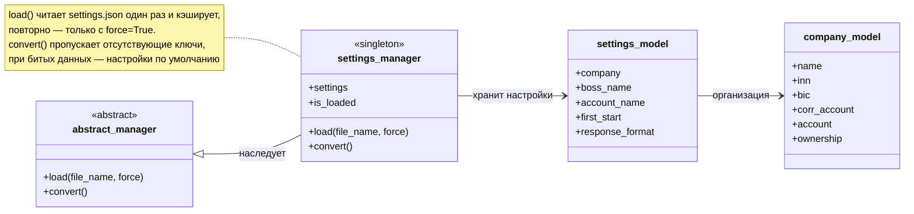
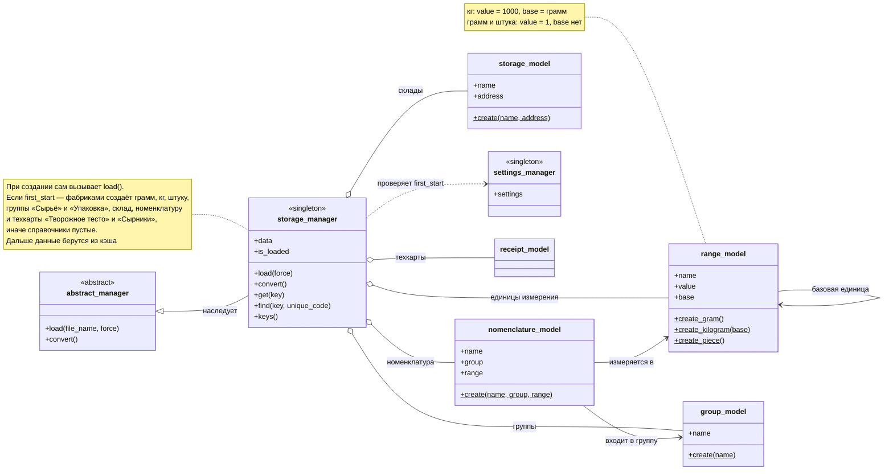
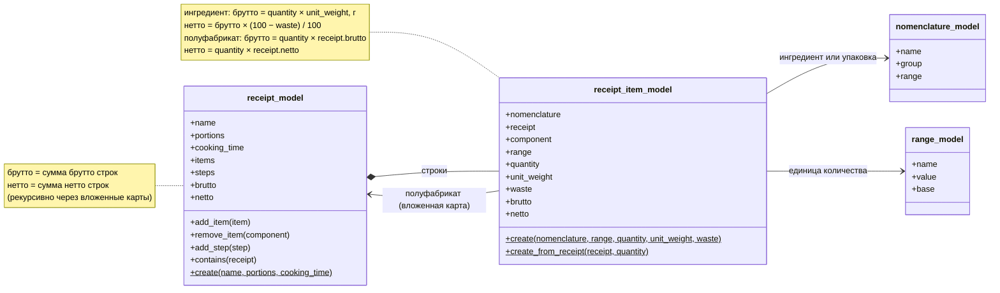
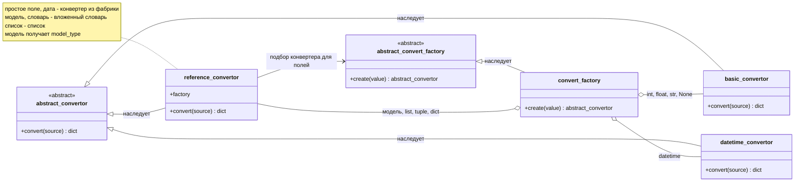
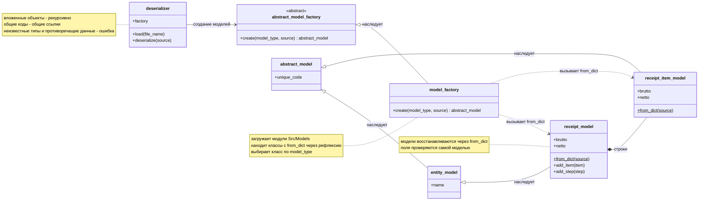

# UML-диаграммы менеджеров

Оба менеджера — singleton: сколько раз ни вызывай конструктор, объект будет один.
И оба кэшируют данные: загрузили один раз — дальше отдают из памяти, пока не попросят `load(force=True)`.
На диаграммах показано только то, чем менеджеры пользуются снаружи — без приватных полей.

## settings_manager

Читает `settings.json` и собирает из него настройки с организацией внутри.

## storage_manager

Хранит справочники и техкарты. Если в настройках включён `first_start`, при первом обращении сам заполняется данными [рецепта](Recipe.md) — через фабричные методы моделей.

## Технологическая карта

Рецепт — это `receipt_model` (корень агрегата): строки меняются только через `add_item()` / `remove_item()`. Строка содержит ингредиент **или** другую техкарту (полуфабрикат, «блюдо в блюде»), поэтому брутто и нетто считаются **рекурсивно** через все уровни вложенности. Вложить карту саму в себя нельзя.

## Конвертеры

Фабрика только подбирает конвертер по типу значения (по таблице "тип - конвертер", с учетом наследования): простые типы - `basic_convertor`, дата - `datetime_convertor`, модели, списки и словари - `reference_convertor`. `reference_convertor` формирует словарь по всем полям объекта: для каждого поля просит конвертер у фабрики, а ссылки разворачивает рекурсивно. Каждая доменная модель получает метку `model_type` с именем класса; словари коллекций такую метку не получают.

## Десериализация

`deserializer.load(file_name)` читает JSON-файл, а `deserialize(source)`
восстанавливает отдельную модель или словарь коллекций. Каждый объект содержит
`model_type`, поэтому его тип не зависит от названия коллекции или поля.
Загрузчик рекурсивно восстанавливает вложенные объекты; повторяющийся
`unique_code` возвращает тот же загруженный экземпляр.

При создании `model_factory` загружает модули из `Src/Models` и через рефлексию
находит конкретные доменные классы с методом `from_dict()`. Фабрика выбирает класс
по `model_type` и передает ему подготовленные поля. Модель создает себя через
свои фабричные методы и сеттеры. Брутто и нетто рассчитываются по составу,
значения этих полей из JSON не присваиваются.

Пример выгрузки: [Json/storage.json](Json/storage.json). Его можно получить
через `GET /api/json`; старые выгрузки без `model_type` нужно сформировать заново.

