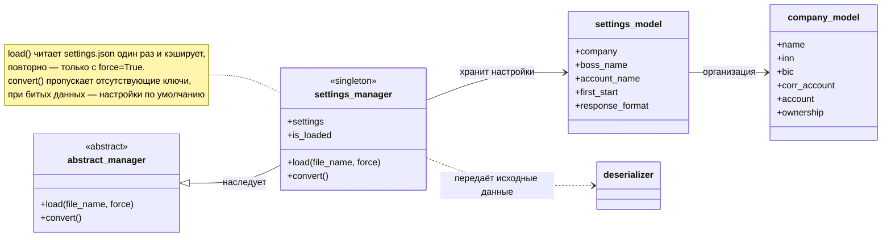
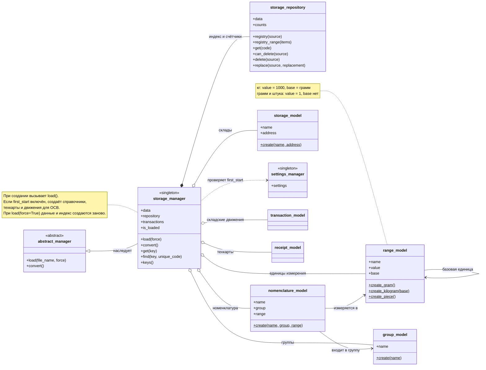
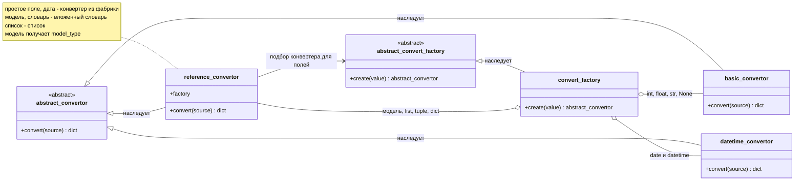
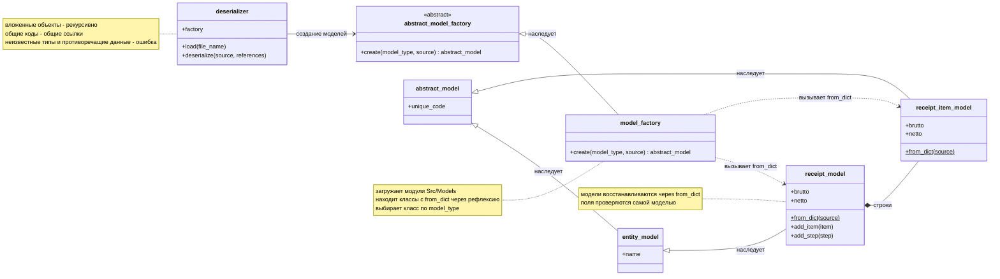
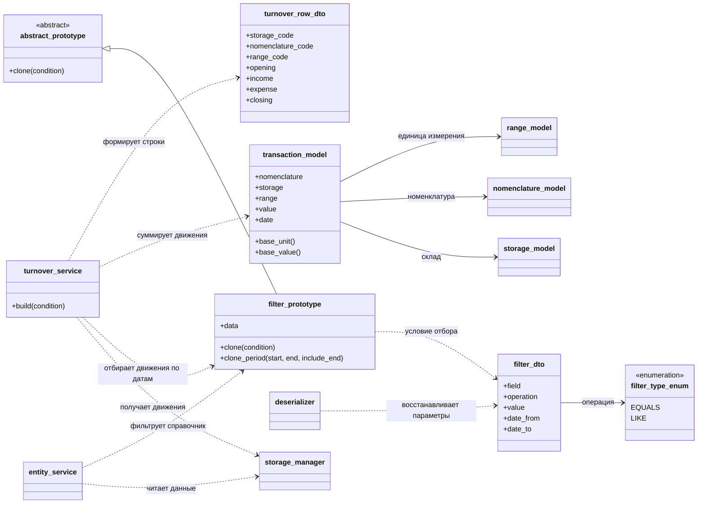

# UML-диаграммы проекта

Оба менеджера — singleton: сколько раз ни вызывай конструктор, объект будет один.
И оба кэшируют данные: загрузили один раз — дальше отдают из памяти, пока не попросят `load(force=True)`.
Диаграммы показывают публичные методы, свойства и связи классов.

## settings_manager

Читает `settings.json` и передаёт плоский словарь в `deserializer`. Тот восстанавливает настройки и карточку организации из полей с префиксом `company_`.



## storage_manager

Хранит справочники, техкарты и складские движения. Если включён `first_start`, менеджер создаёт начальные данные [рецепта](Recipe.md) и учебные движения для ОСВ. Репозиторий индексирует объекты по коду и считает входящие ссылки, включая ссылки из строк рецептов и складских движений. `entity_service` использует репозиторий при создании, изменении и удалении моделей. Удаление используемого объекта и смена его кода возвращают HTTP 409.



## Технологическая карта

Рецепт — это `receipt_model` (корень агрегата): строки меняются только через `add_item()` / `remove_item()`. Строка содержит ингредиент **или** другую техкарту (полуфабрикат, «блюдо в блюде»), поэтому брутто и нетто считаются **рекурсивно** через все уровни вложенности. Вложить карту саму в себя нельзя.


## Конвертеры

Фабрика только подбирает конвертер по типу значения (по таблице "тип - конвертер", с учетом наследования): простые типы - `basic_convertor`, дата - `datetime_convertor`, модели, списки и словари - `reference_convertor`. `reference_convertor` формирует словарь по всем полям объекта: для каждого поля просит конвертер у фабрики, а ссылки разворачивает рекурсивно. Каждая доменная модель получает метку `model_type` с именем класса; словари коллекций такую метку не получают.



## Десериализация

`deserializer.load(file_name)` читает JSON-файл, а `deserialize(source, references)`
восстанавливает отдельную модель, словарь коллекций или плоские настройки.
В выгрузках тип каждой модели задан полем `model_type`. При записи через API
объект вида `{"unique_code": "код"}` разрешается по индексу существующих моделей.
Загрузчик рекурсивно восстанавливает вложенные объекты; повторяющийся
`unique_code` возвращает тот же загруженный экземпляр.

При создании `model_factory` загружает модули из `Src/Models` и через рефлексию
находит конкретные доменные классы с методом `from_dict()`. Фабрика выбирает класс
по `model_type` и передает ему подготовленные поля. Модель создает себя через
свои фабричные методы и сеттеры. Брутто и нетто рассчитываются по составу,
значения этих полей из JSON не присваиваются.

Пример [Json/storage.json](Json/storage.json) показывает пять справочников из
`GET /api/json`. Складские движения хранятся в `storage_manager.transactions`.



## Фильтрация и ОСВ

`entity_service` создаёт прототип из данных хранилища. Вызов `clone(condition)`
возвращает другой прототип с отобранным набором. К нему можно применить следующий
фильтр. API восстанавливает `filter_dto` через общий десериализатор.
Для ОСВ `turnover_service` получает движения из хранилища и через
`filter_prototype` делает две выборки. Сервис считает начальные остатки
и обороты отдельно и объединяет суммы в строки `turnover_row_dto`.



### Фильтр справочника

`POST /api/filter/{entity}` принимает `nomenclature`, `group`, `range` или
`receipt` в маршруте и условие в JSON. `field` указывает на `name` или
`unique_code`, в том числе по пути через связанные модели и списки, например
`items.nomenclature.group.name`. `EQUALS` проверяет точное совпадение с учётом
регистра и применяется по умолчанию. `LIKE` ищет подстроку без учёта регистра.
Пустой объект возвращает весь справочник, при отсутствии совпадений API возвращает `[]`.

Запрос `POST /api/filter/range` ниже возвращает килограмм, у которого базовая
единица называется «грамм».

```json
{"field": "base.name", "operation": "EQUALS", "value": "грамм"}
```

### Оборотно-сальдовая ведомость

`POST /api/turnover` принимает тот же фильтр и необязательные границы периода
`date_from` и `date_to`. Движения до начала периода формируют начальный
остаток. Внутри периода границы включены, а движения после окончания
игнорируются. Без начальной даты `opening` равен нулю. Без конечной даты
верхней границы нет.

Строки ведомости сгруппированы по складу и номенклатуре. Количества приведены
к базовой единице. `expense` показывает величину расхода, а
`closing = opening + income - expense`.

```json
{
  "field": "nomenclature.name",
  "operation": "EQUALS",
  "value": "Пшеничная мука",
  "date_from": "2026-01-02",
  "date_to": "2026-01-03"
}
```

На учебных данных этот запрос возвращает начальный остаток 1000 г, приход
2000 г, расход 500 г и конечный остаток 2500 г. Спецификация обоих маршрутов
находится в [openapi.yaml](../openapi.yaml).
