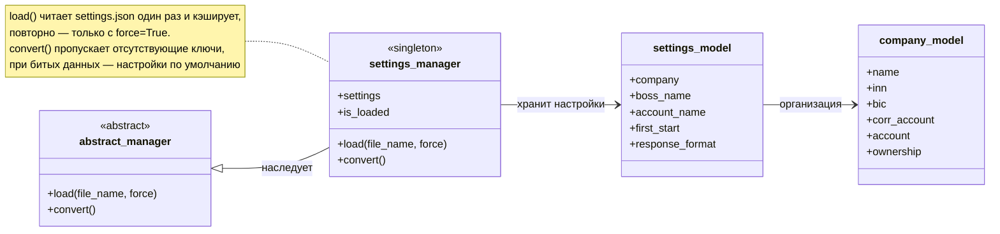
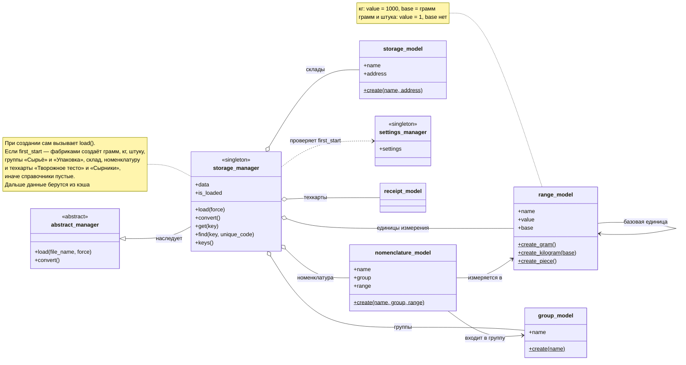
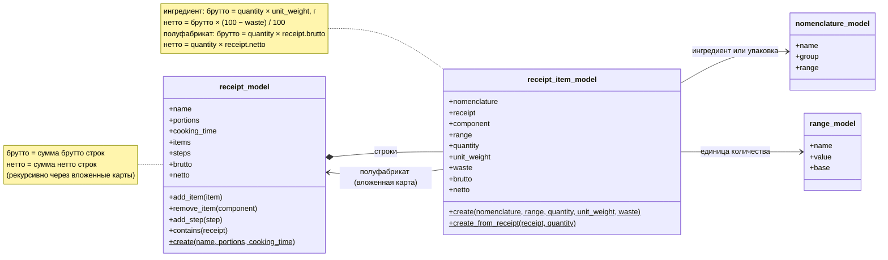
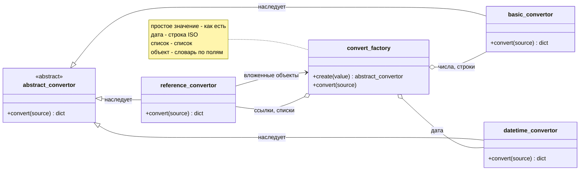

# UML-диаграммы менеджеров

Оба менеджера — singleton: сколько раз ни вызывай конструктор, объект будет один.
И оба кэшируют данные: загрузили один раз — дальше отдают из памяти, пока не попросят `load(force=True)`.
На диаграммах показано только то, чем менеджеры пользуются снаружи — без приватных полей.

## settings_manager

Читает `settings.json` и собирает из него настройки с организацией внутри.

## storage_manager

Хранит справочники и техкарты. Если в настройках включён `first_start`, при первом обращении сам заполняется данными [рецепта](Recipe.md) — через фабричные методы моделей.

## Технологическая карта

Рецепт — это `receipt_model` (корень агрегата): строки меняются только через `add_item()` / `remove_item()`. Строка содержит ингредиент **или** другую техкарту (полуфабрикат, «блюдо в блюде»), поэтому брутто и нетто считаются **рекурсивно** через все уровни вложенности. Вложить карту саму в себя нельзя.

## Конвертеры

`convert_factory` превращает любой объект в набор словарей по его структуре (например, для JSON). По типу значения поля фабрика выбирает конвертер: простые типы — `basic_convertor`, дата — `datetime_convertor`, ссылки на модели и списки — `reference_convertor`, который вложенные объекты снова отдаёт фабрике.

